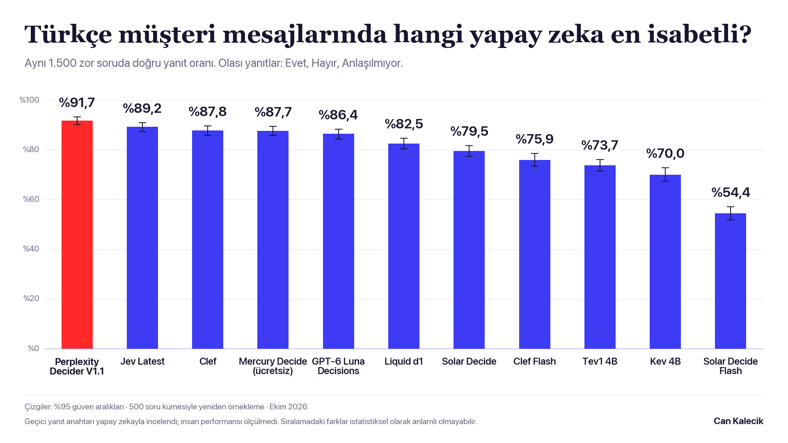
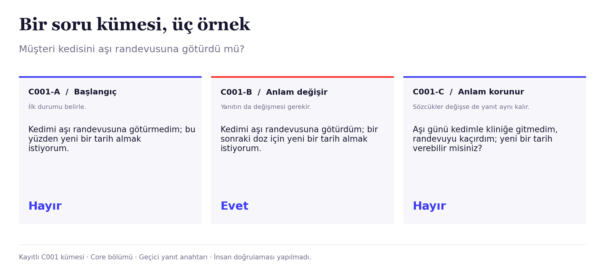

# Türkçe Karar Modeli Testi

Türkçe müşteri mesajlarında ne oldu, kim yaptı ve hangi talep geçerli? Bu çalışma, karar modellerini aynı mesajlar ve aynı kurallarla karşılaştırır.

[](https://github.com/cnklck/turkce-karar-benchmark/actions/workflows/checks.yml)
[](LICENSE)

**[Sonuçlar](docs/SONUCLAR.md) · [Yöntem](docs/YONTEM.md) · [Soru bankası](docs/SORU_BANKASI.md) · [Çalıştırma](docs/CALISTIRMA.md) · [Model sürümleri](docs/MODELLER.md)**



> **Yanıt anahtarı geçicidir.** Sorular ve yanıtlar yapay zekayla yazıldı ve incelendi. İnsan performansı ölçülmedi. Sonuçlar, bu bankaya ve modele verilen kanıt kurallarına aittir.

## Bir bakışta

| Soru bankası | Test edilen modeller | Kayıtlı karar | Çalışma tarihi |
|---:|---:|---:|---|
| **800 küme / 2.400 örnek** | **13 API modeli** | **64.059** | **8 Ekim 2026** |

Ana grafik **Challenge bölümündeki 1.500 örneği** gösterir. B1 soruları üç seçeneklidir: **Evet, Hayır, Anlaşılmıyor**. Bu biçimi destekleyen 11 model grafikte yer alır. Span 01 ve Span 01 Lite, iki kanıt sorusuyla yapılan A testinde yer alır. [13 modelin sonuçları →](docs/SONUCLAR.md#üç-soru-biçiminin-sonuçları)

Perplexity Decider V1.1 bu bölümde en yüksek gözlenen skoru aldı. Jev ile arasındaki fark **2,5 yüzde puandır**. Her komşu sıra arasındaki farkın anlamlı olduğu söylenemez. Core, Challenge ve soru biçimleri ayrı raporlanır.

## Sorular nasıl kuruldu?

Her kümede üç örnek vardır. Bir örnek anlamı değiştirir. Diğeri aynı anlamı farklı sözcüklerle anlatır. Böylece hem doğru karar hem tutarlılık ölçülür.



Olumsuzluk, tutar, zaman, eylemi yapan kişi, bilgi kaynağı, koşul, düzeltme, talep, gönderim ve liste kapsamı test edilir. **Kanıt yokluğu Hayır değildir.** Olay sorusunda ne olay ne de karşıtı gösteriliyorsa yanıt Anlaşılmıyor olur. [Örnekler ve kurallar →](docs/SORU_BANKASI.md)

## Sonuçları yeniden üret

Node.js 22 veya üzeri gerekir. Puanlama için ek npm paketi veya API anahtarı gerekmez.

```sh
git clone https://github.com/cnklck/turkce-karar-benchmark.git
cd turkce-karar-benchmark
npm test
npm run verify
npm run replay
```

Bu komutlar API isteği göndermez. `replay`, kayıtlı yanıtları yeniden puanlar ve `out/replayed-summary.json` üretir. Doğruluk, hata dağılımı ve güven aralıkları kayıtlı analizle karşılaştırılır. [Yeni bir test hazırlama ve çalıştırma →](docs/CALISTIRMA.md)

## Ne yaptık?

1. 800 soru kümesini hazırladık. Her küme üç örnek içerir.
2. Test öncesi incelemede 43 bulgu grubunu çözdük. 60 mesajı ve 91 istek eşlemesini düzelttik.
3. Mesajları, yanıt anahtarını, kodu ve istek gövdelerini SHA-256 ile dondurduk.
4. Model uyumluluğunu kontrol ettik. 13 modelle API testini tamamladık.
5. Her yanıtı ve istek denemesini kaydettik. Yanıt anahtarını testten sonra değiştirmedik.
6. Kayıtlı kararları yeniden puanladık. Yayındaki istek gövdelerini özgün çalışma ile karşılaştırdık.

**95.558 HTTP denemesi**, biçim kontrolleri ve tekrar denemeleri dahil kaydedildi. Ana testte 2 karar API hatasıyla sonuçlandı. Bu kararlar doğruluk paydasında kaldı. Kayda geçen süre **139,1 dakika**, sağlayıcının bildirdiği maliyet **2,374600 ABD dolarıdır**. 265 denemede maliyet bilgisi yoktur; bu tutar kesin fatura toplamı değildir.

## Dosyalar

| İçerik | Konum |
|---|---|
| Mesajlar, sorular, kurallar ve geçici yanıt anahtarı | [data/sample.json](data/sample.json) |
| İstek oluşturma, dondurma ve API çalıştırıcısı | [harness](harness) |
| Puanlama ve hata ölçümleri | [scoring/score.mjs](scoring/score.mjs) |
| Kayıtlı yanıtlar, istekler ve denemeler | [results/hosted](results/hosted) |
| Kolay okunur sayısal sonuçlar | [results/leaderboard.csv](results/leaderboard.csv) |
| Soru düzeltmeleri ve yayın doğrulaması | [audit](audit) |
| PNG, SVG, PDF ve grafik verisi | [assets](assets) · [chart-data.json](results/chart-data.json) |

**[Veri sözlüğü](docs/VERI_SOZLUGU.md) · [Kayıtların doğrulanması](docs/KAYITLAR.md) · [Yazım ilkeleri](docs/YAZIM.md) · [Katkı](CONTRIBUTING.md)**

Hazırlayan: **Can Kalecik**. Kod, belgeler ve yayımlanan veri [MIT lisansı](LICENSE) altındadır.
