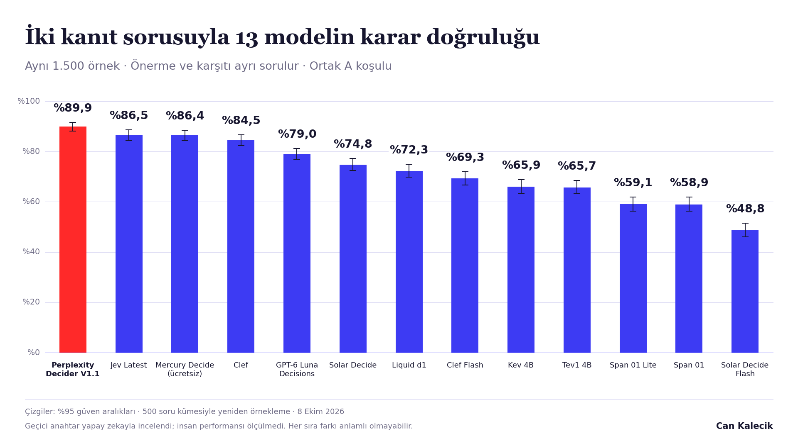

# Sonuçlar

[← Ana sayfa](../README.md)

Bu sayfa 8 Ekim 2026 tarihli API testini açıklar. Yanıt anahtarı yapay zekayla incelendi. İnsan doğrulaması yapılmadı. Sayısal kaynak: [analysis.json](../results/hosted/analysis.json).

## Üç seçenekli sorular: B1

Her model Core bölümünde 600, Challenge bölümünde 1.500 örneği yanıtladı. Sütunlar aynı soru biçimini gösterir. Bölümler birbirine eklenmez.

| Model | Core · 600 örnek | Challenge · 1.500 örnek | Challenge · %95 güven aralığı |
|---|---:|---:|---:|
| Perplexity Decider V1.1 | %94,7 | **%91,7** | %90,1–%93,3 |
| Jev Latest | %91,7 | **%89,2** | %87,3–%91,0 |
| Clef | %92,3 | **%87,8** | %85,9–%89,7 |
| Mercury Decide (ücretsiz) | %92,2 | **%87,7** | %85,8–%89,5 |
| GPT-6 Luna Decisions | %87,7 | **%86,4** | %84,4–%88,3 |
| Liquid d1 | %86,8 | **%82,5** | %80,4–%84,6 |
| Solar Decide | %80,7 | **%79,5** | %77,4–%81,7 |
| Clef Flash | %82,2 | **%75,9** | %73,5–%78,5 |
| Tev1 4B | %79,3 | **%73,7** | %71,5–%76,1 |
| Kev 4B | %74,8 | **%70,0** | %67,3–%72,7 |
| Solar Decide Flash | %56,0 | **%54,4** | %51,8–%57,1 |

Çizgiler %95 güven aralıklarıdır. Hesaplama, aynı kümenin üç örneğini birlikte yeniden örnekler. Kırmızı sütun en yüksek gözlenen skoru gösterir. Diğer sütunlar aynı renktedir. [Grafiğin metin karşılığı](../assets/full-hosted-alt.txt)

Perplexity ile Jev arasındaki fark, Perplexity lehine 2,53 yüzde puandır. Eşleşmiş küme hesabında %95 fark aralığı **1,00–4,13 yüzde puandır**. Holm düzeltmeli işaret testi p değeri **0,00526** olarak hesaplandı. Bu sonuç bu bankadaki B1 Challenge karşılaştırmasına aittir. Genel bir model üstünlüğü kanıtlamaz.

İkili testler her bölüm ve soru biçimi içinde düzeltilir. Fark aralıkları ayrı %95 aralıklardır; eşzamanlı aralık olarak hesaplanmadı. Tam karşılaştırmalar `analysis.json` içindeki `paired` alanındadır.

## Üç soru biçiminin sonuçları

Aşağıdaki değerlerin tümü Challenge bölümüne aittir. A ve B1 için payda 1.500 örnektir. B2 yalnızca kişi sorusu bulunan **234 örnekte** çalışır. Bu yüzden A, B1 ve B2 için tek bir ortalama skor verilmez.

| Model | A · iki kanıt sorusu | B1 · üç seçenek | B2 · kişi seçimi |
|---|---:|---:|---:|
| Perplexity Decider V1.1 | %89,9 | %91,7 | %94,0 |
| Jev Latest | %86,5 | %89,2 | %90,6 |
| Clef | %84,5 | %87,8 | %88,9 |
| Mercury Decide (ücretsiz) | %86,4 | %87,7 | %92,7 |
| GPT-6 Luna Decisions | %79,0 | %86,4 | %92,7 |
| Liquid d1 | %72,3 | %82,5 | %86,3 |
| Solar Decide | %74,8 | %79,5 | %83,8 |
| Clef Flash | %69,3 | %75,9 | %81,2 |
| Tev1 4B | %65,7 | %73,7 | %79,9 |
| Kev 4B | %65,9 | %70,0 | %78,2 |
| Solar Decide Flash | %48,8 | %54,4 | %64,1 |
| Span 01 | %58,9 | — | — |
| Span 01 Lite | %59,1 | — | — |

**—:** Bu çalışma planında soru biçimi desteklenmiyor. Değer sıfır değildir. Span modelleri yalnızca A testine katıldı.

A testinde önerme ile karşıtı ayrı sorulur. İki yanıt tek karara dönüştürülür. İkisini birden doğru sayan yanıt çelişkilidir ve yanlış puanlanır. [Grafiğin metin karşılığı](../assets/evidence-questions-alt.txt)

Jev için iki kanıt sorusunun tek istekte gönderildiği ek bir koşul da ölçüldü. Bu koşulun Challenge doğruluğu **%86,5** oldu. Ortak A koşuluyla veya B1 ile birleştirilmedi. Tam kayıt `analysis.json` içindeki `nativeJev` alanındadır.

## Belirsizlik ve tutarlılık

B1 Challenge bölümünde **409 olay sorusunun** geçici anahtarı Anlaşılmıyor'dur. İlk sütun bu 409 örnekteki doğru yanıt oranıdır. Dayanaksız Evet/Hayır sayısı, belirsiz bir olay için kesin karar verildiğini gösterir.

| Model | Belirsiz olaylarda doğru yanıt | Dayanaksız Evet/Hayır | Anlam değişen çift: ikisi de doğru | Anlam korunan çift: ikisi de doğru |
|---|---:|---:|---:|---:|
| Perplexity Decider V1.1 | %82,9 | 70 / 409 | %82,8 | %90,0 |
| Jev Latest | %81,4 | 76 / 409 | %78,8 | %86,2 |
| Clef | %76,3 | 97 / 409 | %75,0 | %85,0 |
| Mercury Decide (ücretsiz) | %81,2 | 77 / 409 | %73,6 | %86,6 |
| GPT-6 Luna Decisions | %81,7 | 75 / 409 | %73,2 | %83,2 |
| Liquid d1 | %63,1 | 151 / 409 | %65,2 | %77,8 |
| Solar Decide | %80,7 | 79 / 409 | %62,4 | %70,0 |
| Clef Flash | %58,7 | 169 / 409 | %54,2 | %70,6 |
| Tev1 4B | %43,3 | 232 / 409 | %49,8 | %66,6 |
| Kev 4B | %59,4 | 166 / 409 | %47,2 | %62,2 |
| Solar Decide Flash | %70,4 | 121 / 409 | %24,0 | %46,4 |

Çift doğruluğunda payda 500 soru kümesidir. İki örneğin de doğru olması gerekir. Aynı yanıtı vermek, iki örneği doğru yanıtlamakla aynı ölçüm değildir. Anlam korunan çiftlerin aynı yanıt oranı ayrıca kaydedilir.

## Süre, istek ve maliyet

| Ölçüm | Kayıtlı değer |
|---|---:|
| Planlanan karar | 64.059 |
| Kaydedilen karar | 64.059 |
| Planlanan ilk istek bileşeni | 95.259 |
| Ana test HTTP denemesi | 95.522 |
| Test öncesi biçim kontrolü | 36 |
| Tüm HTTP denemeleri | 95.558 |
| Ana testte başarısız HTTP denemesi | 265 |
| Ana testte tekrar denemesi | 263 |
| Son yanıtı API hatası olan karar | 2 |
| Ana test süresi | 139,1 dakika |
| Sağlayıcının bildirdiği maliyet | 2,374600 ABD doları |
| Maliyet bilgisi olmayan deneme | 265 |

Bir karar, soru biçimine göre bir veya iki istek içerir. Tekrar denemeleri de istek sayısına eklenir. Bu nedenle karar sayısı ile HTTP denemesi sayısı farklıdır.

Maliyet kaydı biçim kontrollerini, hataları ve tekrarları içerir. Eksik maliyet sıfır sayılmadı. Bildirilen tutar bilinen kısmın toplamıdır. İki nihai API hatası A testindedir: Perplexity Challenge ve GPT-6 Luna Core. İkisi de kendi paydasında kaldı.

Süre, ağ yolu, sağlayıcı kuyruğu, eşzamanlı istekler ve tekrar denemelerinden etkilenir. Buradaki gecikmeler bu çalışmanın ölçümüdür. Salt model işlem hızını göstermez. [Model bazında kullanım kaydı](../results/hosted/usage.json)

## Bu sonuçların sınırı

- Banka sentetiktir. Gerçek müşteri trafiğindeki hata oranı ölçülmedi.
- Yanıt anahtarı geçicidir. Anlaşmazlık halinde kaydedilen kanıt kuralı esas alınmalıdır.
- Core ve Challenge, yazarların belirlediği bölümlerdir. İnsan zorluğu ölçülmedi.
- Her örnek, her koşulda bir kez değerlendirildi. Tekrar çalışmalardaki değişkenlik ölçülmedi.
- Model adı bir hizmet takma adı olabilir. Sunulan model kimlikleri ayrıca kaydedildi.
- Bu sürüm temel Türkçe soru biçimini kullanır. Önceki tasarımdaki yedi ayrı soru varyantı bu tam çalışmada uygulanmadı.

[CSV tablosu](../results/leaderboard.csv) · [Yöntem](YONTEM.md) · [Model kimlikleri](MODELLER.md)
